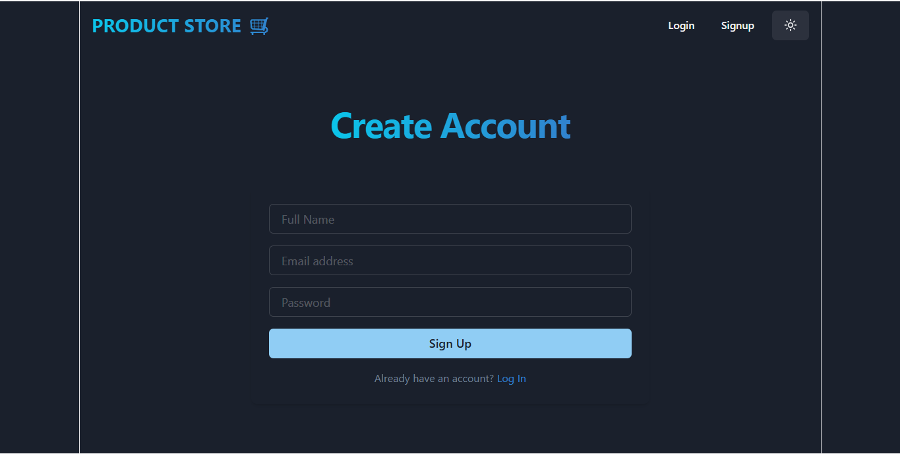
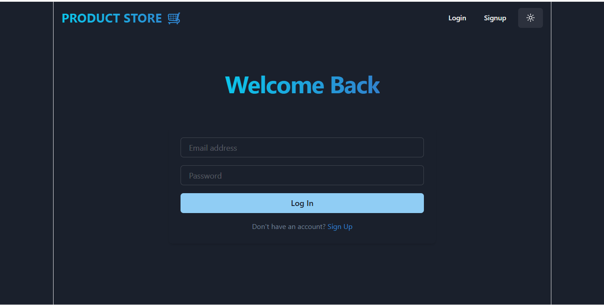
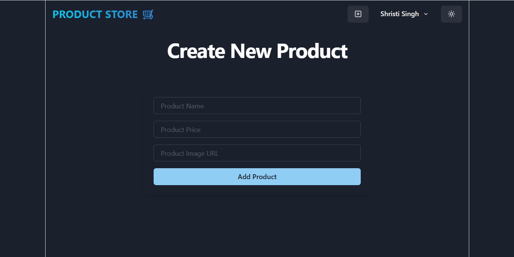

<div align="center">

# 🛒 Product Store

An end-to-end full-stack web application for product catalog management featuring JWT-based authentication, protected API routes, and a responsive modern user interface.

[](https://react.dev/)
[](https://tailwindcss.com/)
[](LICENSE)

</div>

---

## 📸 Screenshots

### 🔐 Authentication Flow
| Sign Up | Log In |
| :---: | :---: |
|  |  |

---

### 📦 Product Management
| Create New Product | Catalog Preview |
| :---: | :---: |
|  |  |

---

## 🚀 Key Features

- **JWT Authentication:** Secure user signup and login workflows with password hashing using `bcryptjs`.
- **Role-Gated Actions:** Product creation, updates, and removals are protected by middleware verifying Bearer tokens.
- **Dynamic Theme Mode:** Dark and light theme toggle support across the layout.
- **CRUD Inventory Operations:** Direct modal and inline interfaces to add, modify, and delete inventory records with real-time UI synchronization.
- **Client State Management:** Fast, centralized state updates powered by Zustand.
- **Full-Screen Responsiveness:** Tailored viewports optimized for mobile, tablet, and widescreen desktop monitors.

---

## 🛠️ Tech Stack

### Frontend
- **Framework:** React 19 (Vite)
- **Styling:** Tailwind CSS / Chakra UI
- **State Store:** Zustand
- **Navigation:** React Router DOM

### Backend
- **Runtime:** Node.js
- **Server Framework:** Express.js
- **Security:** JSON Web Tokens (JWT), Bcrypt.js
- **Database ODM:** Mongoose

### Database & Tooling
- **Database:** MongoDB Atlas
- **API Testing:** Postman

---

## 📁 Project Structure

```text
ProductStore/
├── backend/
│   ├── controllers/
│   │   ├── AuthController.js
│   │   └── productController.js
│   ├── middlewares/
│   │   ├── authMiddleware.js
│   │   └── AuthValidation.js
│   ├── models/
│   │   ├── product.model.js
│   │   └── Users.js
│   └── server.js
├── frontend/
│   ├── assests/
│   │   ├── createProduct.png
│   │   ├── login.png
│   │   ├── preview.png
│   │   └── signup.png
│   ├── src/
│   │   ├── components/
│   │   ├── pages/
│   │   ├── store/
│   │   ├── App.jsx
│   │   └── main.jsx
│   └── package.json
├── .env.example
├── package.json
└── README.md

```
## 🚀 Getting Started

### Prerequisites

- [Node.js](https://nodejs.org/) installed (v16 or higher)
- [MongoDB](https://www.mongodb.com/) URI connection string

### 1. Clone the Repository

```bash
git clone [https://github.com/your-username/product-store.git]
cd product-store