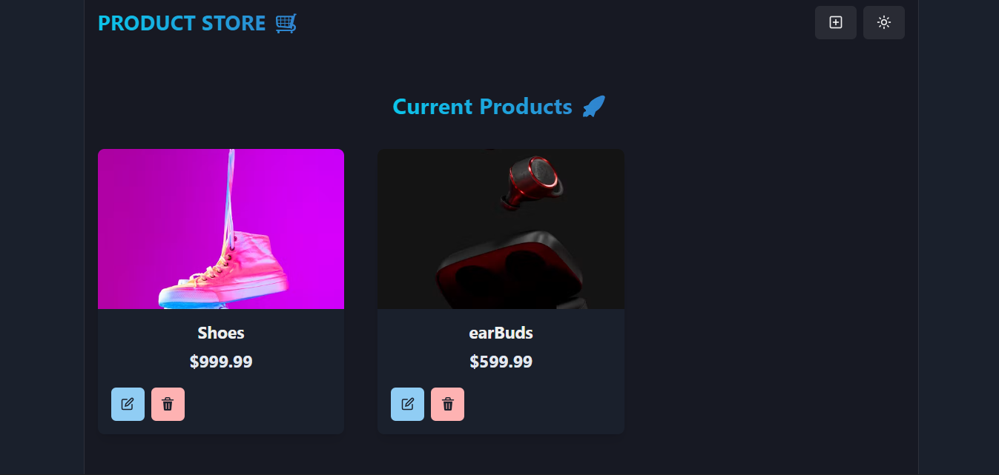

<div align="center">

  <h1>🛒 PRODUCT STORE 🚀</h1>
  <p>A full-stack, responsive product management store built with modern web technologies.</p>

  
---

## 📸 Preview

<div align="center">
  
</div>

> **Tip:** Save your screenshot in the root folder as `preview.png` (or inside an `assets/` directory and update the path).

---

## ✨ Features

- 🌓 **Theme Switching:** Seamless toggle between Dark and Light mode.
- ➕ **Add New Products:** Modal/page interface to add product name, price, and image URL.
- ✏️ **Edit & Update:** Inline/modal editing to update existing catalog details in real-time.
- 🗑️ **Delete Items:** Instantly delete products from the database and sync the view.
- 📱 **Responsive Grid:** Clean card grid layout adapted for mobile, tablet, and desktop screens.

---

## 🛠️ Tech Stack

- **Frontend:** React, Chakra UI / Tailwind CSS, React Router
- **Backend:** Node.js, Express.js
- **Database:** MongoDB & Mongoose
- **State Management:** Zustand / React Context

---

## 🚀 Getting Started

### Prerequisites

- [Node.js](https://nodejs.org/) installed (v16 or higher)
- [MongoDB](https://www.mongodb.com/) URI connection string

### 1. Clone the Repository

```bash
git clone [https://github.com/your-username/product-store.git](https://github.com/your-username/product-store.git)
cd product-store