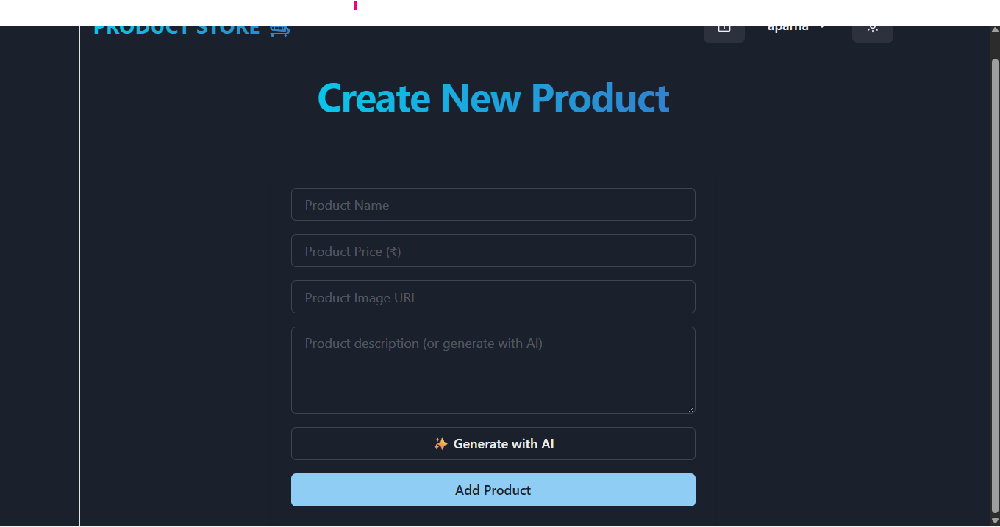
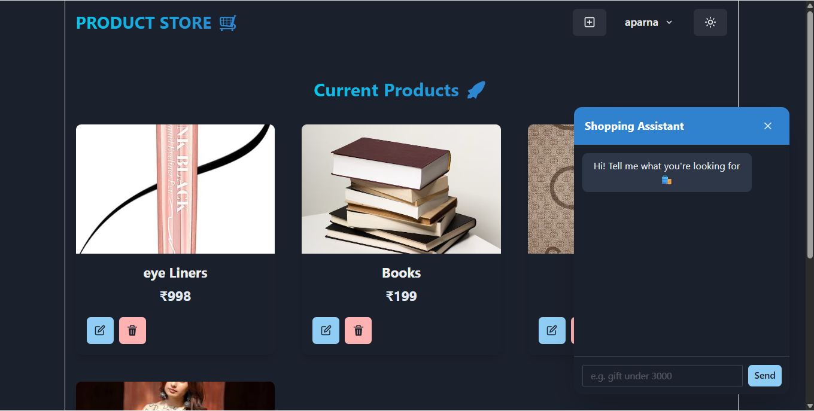
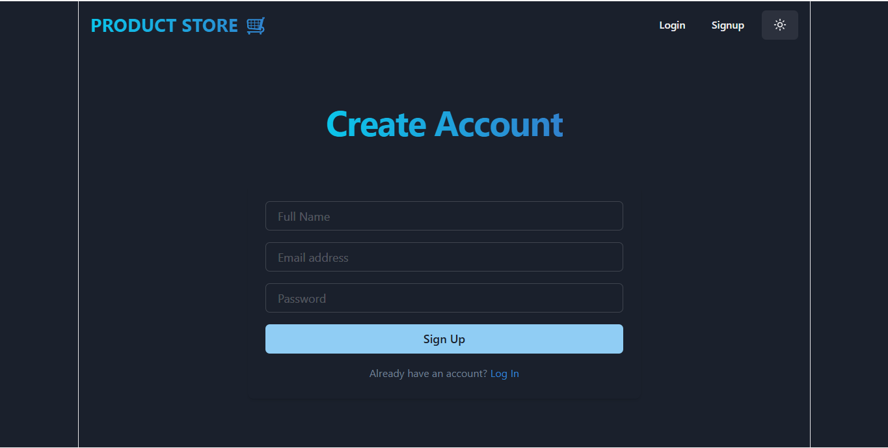
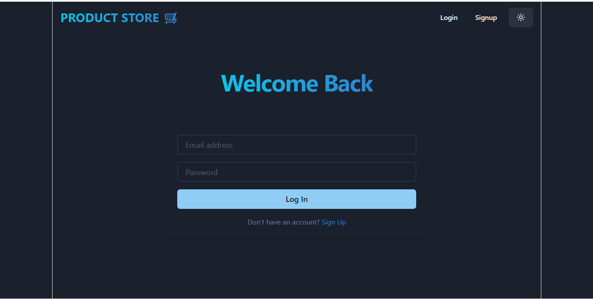
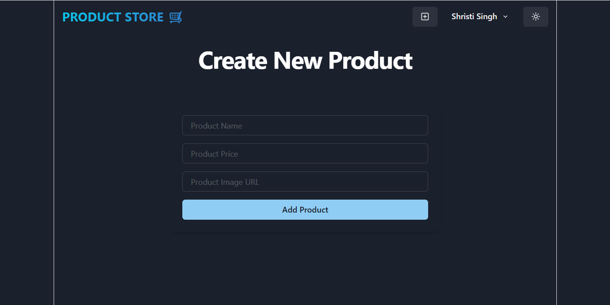
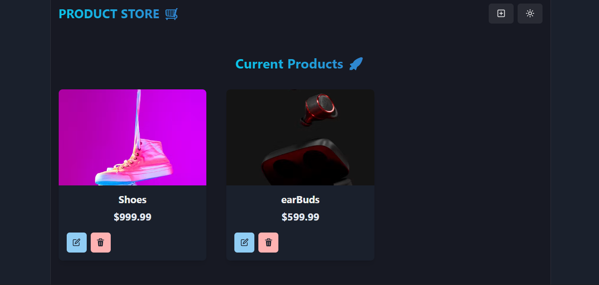
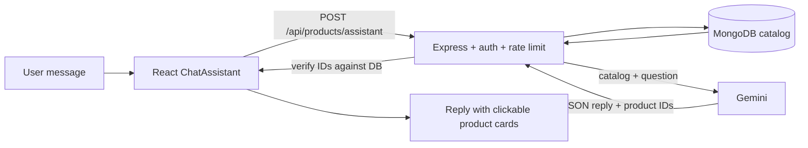
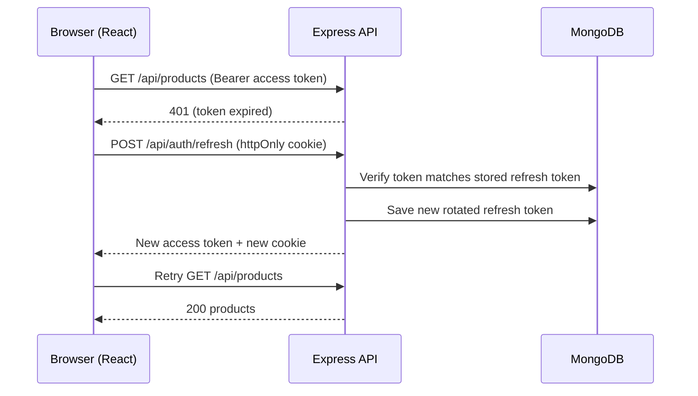

<div align="center">

# 🛒 Product Store

**A full-stack MERN product catalog with production-style authentication and Gemini-powered AI features.**

[](https://react.dev/)
[](https://nodejs.org/)
[](https://www.mongodb.com/atlas)
[](https://chakra-ui.com/)
[](https://aistudio.google.com/)
[](LICENSE)

[Features](#-key-features) •
[AI Features](#-ai-features) •
[Screenshots](#-screenshots) •
[Architecture](#-architecture) •
[Tech Stack](#%EF%B8%8F-tech-stack) •
[API](#-api-reference) •
[Getting Started](#-getting-started)

</div>

---

## 📸 Screenshots

### 🤖 AI Features
| ✨ AI Description Generator | 💬 Shopping Assistant |
| :---: | :---: |
|  |  |

### 🔐 Authentication Flow
| Sign Up | Log In |
| :---: | :---: |
|  |  |

### 📦 Product Management
| Create New Product | Catalog Preview |
| :---: | :---: |
|  |  |

---

## 🚀 Key Features

- **Secure authentication:** Short-lived JWT access tokens plus rotating refresh tokens in `httpOnly` cookies, with reuse detection.
- **Protected API:** Every product route is guarded by Bearer-token middleware.
- **Full CRUD:** Add, edit and delete products with real-time UI sync.
- **Product details page:** Dedicated page for each product, reachable from the catalog and from the AI assistant.
- **Rate limiting:** Global sliding-window limiter (Upstash Redis) protects the API and the AI quota.
- **Dark / light mode** and a fully responsive layout.
- **Global state with Zustand** and a single `apiFetch` wrapper that attaches tokens and silently refreshes on `401`.

---

## 🤖 AI Features

Powered by **Google Gemini** through the `@google/genai` SDK.

| Feature | What it does | Where |
| --- | --- | --- |
| ✨ **AI Description Generator** | Writes a clean product description from just the product name, or polishes the seller's rough notes | Create Product page, "Generate with AI" button |
| 💬 **Shopping Assistant** | Chat widget that answers questions like *"gift under 3000"* using only the store's real products, and shows clickable product cards | Floating chat on the home page |
| 🧩 **Similar Products** | "You may also like" suggestions on every product page, with a price-based fallback if the AI is unavailable | Product details page |

<details>
<summary><b>🧠 How the AI is engineered (click to expand)</b></summary>

<br>

- **One service layer:** every Gemini call lives in `backend/services/ai.services.js` behind a single `generate()` helper.
- **Resilience:** retries on `503 (model busy)` with backoff, then falls back to a second model. Controllers map errors (rate limit, busy, network) to friendly messages.
- **Structured output:** the assistant and similar-products features request JSON with a response schema, so the backend never parses free text.
- **AI output is never trusted blindly:** product IDs returned by the model are verified against real database records before anything is shown, so hallucinated products are dropped.
- **Grounded answers:** the assistant is instructed to answer only from the supplied catalog and to treat catalog text as data, not instructions (basic prompt-injection defence).
- **Cost control:** AI routes require login, sit behind the rate limiter, cap input length and chat history, and similar-product results are cached for 10 minutes.

</details>



---

## 🔐 Authentication Design

- **Access token:** 15 minutes, kept **in memory** (Zustand), never in `localStorage`.
- **Refresh token:** 7 days, `httpOnly` cookie, stored in the DB, **rotated on every refresh**.
- **Reuse detection:** replaying an old refresh token clears the session and forces a fresh login.
- **Silent restore:** on page reload the app calls `/api/auth/refresh` once (a shared promise prevents parallel refreshes).
- **Validation and hashing:** Joi request validation and `bcrypt` password hashing.



---

## 🛠️ Tech Stack

### Frontend
- **Framework:** React (Vite)
- **UI:** Chakra UI
- **State:** Zustand
- **Routing:** React Router DOM

### Backend
- **Runtime:** Node.js, Express 5
- **Security:** JSON Web Tokens, bcrypt, cookie-parser, Joi
- **Rate limiting:** Upstash Redis + `@upstash/ratelimit`
- **AI:** Google Gemini (`@google/genai`)
- **ODM:** Mongoose

### Database & Tooling
- **Database:** MongoDB Atlas
- **API testing:** Postman

---

## 📁 Project Structure

```text
ProductStore/
├── backend/
│   ├── config/
│   │   ├── db.js
│   │   └── upstash.js
│   ├── controller/
│   │   ├── AuthController.js
│   │   └── productController.js
│   ├── middleware/
│   │   ├── auth.js
│   │   ├── AuthValidation.js
│   │   └── rateLimiter.js
│   ├── models/
│   │   ├── Users.js
│   │   └── product.js
│   ├── routes/
│   │   ├── AuthRouter.js
│   │   └── product-routes.js
│   ├── services/
│   │   └── ai.services.js        # all Gemini calls
│   └── server.js
├── frontend/
│   ├── assests/                  # README screenshots
│   ├── src/
│   │   ├── components/           # Navbar, ProductCard, ChatAssistant
│   │   ├── pages/                # Home, Create, Login, Signup, ProductDetail
│   │   ├── store/                # auth.js, product.js (Zustand)
│   │   ├── apiFetch.js           # token + auto-refresh wrapper
│   │   ├── App.jsx
│   │   └── main.jsx
│   └── package.json
├── .env.example
├── package.json
└── README.md
```

---

## 📡 API Reference

<details>
<summary><b>Auth endpoints</b> (<code>/api/auth</code>)</summary>

<br>

| Method | Route | Description |
| --- | --- | --- |
| POST | `/signup` | Create an account |
| POST | `/login` | Returns access token and sets the refresh cookie |
| POST | `/refresh` | Rotates the refresh token and returns a new access token |
| POST | `/logout` | Clears the refresh token |

</details>

<details>
<summary><b>Product endpoints</b> (<code>/api/products</code>, all require <code>Authorization: Bearer &lt;token&gt;</code>)</summary>

<br>

| Method | Route | Description |
| --- | --- | --- |
| GET | `/` | List products |
| GET | `/:id` | Get a single product |
| POST | `/` | Create a product |
| PUT | `/:id` | Update a product |
| DELETE | `/:id` | Delete a product |
| POST | `/generate-description` | 🤖 AI product description |
| POST | `/assistant` | 🤖 Shopping assistant chat |
| GET | `/:id/similar` | 🤖 Similar product suggestions |

</details>

---

## 🚀 Getting Started

### Prerequisites

- [Node.js](https://nodejs.org/) v18 or higher
- A [MongoDB Atlas](https://www.mongodb.com/atlas) connection string
- A free [Upstash Redis](https://upstash.com/) database (for rate limiting)
- A free [Gemini API key](https://aistudio.google.com/) (for the AI features)

### 1. Clone the repository

```bash
git clone https://github.com/Aparna123477/product-store.git
cd product-store
```

### 2. Install dependencies

```bash
npm install
npm install --prefix frontend
```

### 3. Configure environment variables

Create a `.env` file in the project root (see `.env.example`). **Never commit this file.**

```env
PORT=5000
MONGO_URI=your_mongodb_connection_string

JWT_SECRET=a_long_random_string
JWT_REFRESH_SECRET=another_long_random_string

UPSTASH_REDIS_REST_URL=your_upstash_url
UPSTASH_REDIS_REST_TOKEN=your_upstash_token

GEMINI_API_KEY=your_gemini_api_key
GEMINI_MODEL=your_gemini_model_name
GEMINI_FALLBACK_MODEL=optional_second_model
```

> Use a model name that is available in your Google AI Studio account.

### 4. Run in development

```bash
# Terminal 1 (project root): backend with auto-restart
npm run dev

# Terminal 2: frontend
cd frontend
npm run dev
```

Open **http://localhost:5173**.

### 5. Production build

```bash
npm run build
npm start
```

Open **http://localhost:5000**.

---

## 🧭 Roadmap

- [ ] Natural-language smart search
- [ ] Embeddings and vector search for large catalogs (RAG)
- [ ] Admin role (only admins can create, edit and delete products)
- [ ] Persist chat history
- [ ] Automated tests for the auth flow
- [ ] Deployment (Render + MongoDB Atlas)

---

## 🤝 Contributing

Contributions, issues and feature requests are welcome. Feel free to open an issue or submit a pull request.

## 📄 License

Distributed under the MIT License. See `LICENSE` for details.

<div align="center">

**If you found this project useful, please consider giving it a ⭐**

[⬆ Back to top](#-product-store)

</div>
